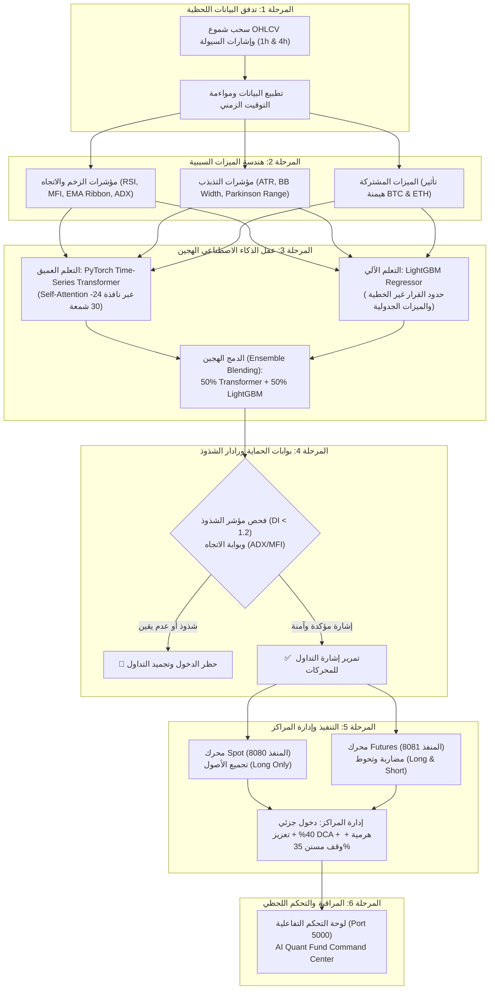
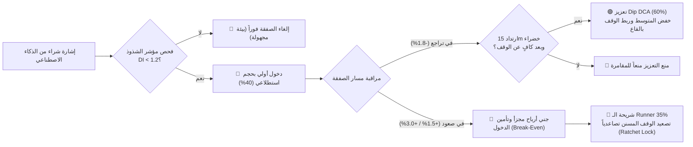

# 🏛️ عرض تقديمي تنفيذي: منصة الذكاء الاصطناعي للتداول الكمي
## Institutional AI Crypto Quant Fund: Dual-Engine & Hybrid Intelligence

---

```
  ____                  _          ___                   _     _____                 _ 
 / ___|_ __ _   _ _ __ | |_ ___   / _ \ _   _  __ _ _ __ | |_  |  ___|   _ _ __   __| |
| |   | '__| | | | '_ \| __/ _ \ | | | | | | |/ _` | '_ \| __| | |_ | | | | '_ \ / _` |
| |___| |  | |_| | |_) | || (_) || |_| | |_| | (_| | | | | |_  |  _|| |_| | | | | (_| |
 \____|_|   \__, | .__/ \__\___/  \__\_\\__,_|\__,_|_| |_|\__| |_|   \__,_|_| |_|\__,_|
            |___/|_|                                                                    
```

---

## 📑 جدول المحتويات (Agenda)

1. **الرؤية المؤسسية وفلسفة الصندوق (Vision & Quantitative Philosophy)**
2. **المعمارية التقنية ومراحل خط العمل (System Architecture & Pipeline)**
3. **طبقة الذكاء الاصطناعي الهجين: التعلم العميق والتعلم الآلي (Hybrid AI Models)**
4. **صياغة الهدف وأفق التنبؤ الرياضي (Target Formulation & Forecast Horizon)**
5. **هندسة الميزات السببية ومنع التسريب الزمني (Causal Feature Engineering)**
6. **مقاييس الدقة التنبؤية والأداء المالي (Accuracy, Metrics & Financial Edge)**
7. **صمام الأمان المؤسسي وإدارة المخاطر (Institutional Risk & Dynamic Scaling)**
8. **محطة التدريب السحابي والأداء اللحظي (Google Colab GPU Hub & Live Dashboard)**
9. **الخلاصة والقيمة التنافسية (Executive Summary & Competitive Advantage)**

---

## 🏛️ الشريحة 1: الرؤية المؤسسية وفلسفة الصندوق

### التحول من التداول العشوائي إلى الهندسة المالية الكمية

في أسواق العملات الرقمية التقليدية، يفشل أكثر من 90% من المتداولين بسبب العواطف، الرافعة المالية المفرطة، واستخدام مؤشرات فنية ثابتة ومتأخرة. صُمم هذا المشروع ليحاكي أسلوب **صناديق التحوط الكمية العالمية (Institutional Quant Hedge Funds)** مثل *Two Sigma* و *Renaissance Technologies*.

### المبادئ الحاكمة للنموذج:
* **التنبؤ المستمر القائم على البيانات:** الاعتماد على نماذج تعلّم آلي متطورة تعيد تدريب نفسها دورياً للتكيف مع ديناميكية الأسواق.
* **الفصل الهيكلي بين التجميع والمضاربة (Dual-Engine Architecture):**
  * **محرك الـ Spot:** مخصص لبناء وتنمية رأس المال الصافي بدون رافعة مالية وبصفر احتمالية للتصفية (Zero Liquidation Risk).
  * **محرك الـ Futures:** مخصص لاقتناص الفرص السريعة، تسييل الهبوط عبر البيع المكشوف (Shorting)، والتحوط ضد الهزات العنيفة برافعة منضبطة (1.5x - 2.0x).
* **حظر التداول في ظروف الشذوذ (Zero Blind Trading):** إذا لم يتعرف الذكاء الاصطناعي على بيئة السوق، يمتنع فوراً عن اتخاذ أي مركز مالي لحماية رأس المال.

---

## 🏗️ الشريحة 2: المعمارية التقنية ومراحل خط العمل (Pipeline)



---

## 🧠 الشريحة 3: نماذج الذكاء الاصطناعي (التعلم العميق + التعلم الآلي)

تم بناء عقل النظام عبر **معمارية هجينة مبتكرة (Hybrid Ensemble Architecture)** تدمج بين قوتين متباينتين في علوم البيانات:

```
┌─────────────────────────────────────────────────────────────────────────┐
│              🏛️ Institutional HybridTreeTransformer Architecture         │
└─────────────────────────────────────────────────────────────────────────┘
                                     │
           ┌─────────────────────────┴─────────────────────────┐
           ▼                                                   ▼
┌──────────────────────────────────────┐    ┌──────────────────────────────────────┐
│  🤖 التعلم العميق (Deep Learning)    │    │  🌲 التعلم الآلي (Machine Learning)  │
│  PyTorch Time-Series Transformer     │    │  LightGBM Gradient Boosted Trees     │
├──────────────────────────────────────┤    ├──────────────────────────────────────┤
│ • آلية الانتباه المتعدد Multi-Head   │    │ • هيكل شجري سريع ودقيق جداً          │
│ • نافذة انزلاقية زمنية (24-30 شمعة)  │    │ • بارع في اكتشاف الفواصل الحادة      │
│ • التقاط العلاقات والأنماط التاريخية │    │ • يعالج الميزات المقطعية والزخم      │
│ • تمثيل ديناميكي لتغيرات السوق       │    │ • مقاوم للضوضاء السعرية السريعة      │
└──────────────────────────────────────┘    └──────────────────────────────────────┘
           │                                                   │
           └─────────────────────────┬─────────────────────────┘
                                     ▼
                  ┌─────────────────────────────────────┐
                  │ ⚖️ الدمج الهجين (Ensemble Blending)  │
                  │   y = 0.50 * Trans + 0.50 * LGBM    │
                  └─────────────────────────────────────┘
                                     ▼
                   توقع فائق الاستقرار، منخفض التباين،
                    وذو معامل معلومات (IC) مرتفع
```

### 1. نموذج التعلم العميق: `PyTorchTransformerRegressor`
* **المعمارية:** Time-Series Transformer مزود بطبقات Multi-Head Self-Attention وطبقات تغذية أمامية (Feed-Forward) مع Dropout بنسبة 20% لمنع الإفراط في الملاءمة.
* **المدخلات:** مصفوفة ثلاثية الأبعاد $\text{Tensor}(B, T, F)$ حيث:
  * $B$: حجم الدفعة (Batch Size = 64).
  * $T$: عمق النافذة الزمنية السابقة (Sliding Window = 24 إلى 30 شمعة).
  * $F$: عدد الميزات المحسوبة (Features).
* **الوظيفة الأساسية:** فهم "سياق الحركة" والذاكرة التتابعية للسعر بدلاً من النظر إلى اللحظة الراهنة بمعزل عما قبلها.

### 2. نموذج التعلم الآلي: `LightGBM Regressor`
* **المعمارية:** Gradient Boosted Decision Tree بمحددات دقيقة (400 شجرة، عمق أقصى 6، معدل تعلم 0.04).
* **الوظيفة الأساسية:** إيجاد الحدود الرقمية الفاصلة بين الحالات الربحية والخاسرة، والتعامل الفوري مع الميزات الجدولية (Tabular Features) مثل مؤشر القوة النسبية ومعدل التذبذب.

### 3. آلية الدمج الرياضي (Meta-Ensemble Blending):
$$y_{\text{final}} = w_{\text{tree}} \cdot \hat{y}_{\text{LGBM}} + w_{\text{transformer}} \cdot \hat{y}_{\text{Transformer}}$$
* **الفلسفة:** يعالج التعلم العميق مسار الزمن، بينما يعالج التعلم الآلي ميزات اللحظة، والدمج بينهما يقضي على عيوب كل نموذج على حدة ويقلل تشتت التنبؤات (Variance Reduction).

---

## 🎯 الشريحة 4: صياغة الهدف التنبؤي وأفق التنبؤ الرياضي

### ماذا يتنبأ به الذكاء الاصطناعي؟
بدلاً من محاولة التنبؤ بالسعر المطلق (وهو أمر غير مجدٍ رياضياً لعدم استقرار السلسلة الزمنية Non-Stationary)، يقوم النموذج بالتنبؤ بـ **نسبة العائد النسبي المستقبلي (Relative Future Return)**:

$$\text{Target} (\&-s\_close) = \frac{\text{Price}_{t + h} - \text{Price}_t}{\text{Price}_t}$$

| المعامل | القيمة | الشرح والتبرير الرياضي |
| :--- | :---: | :--- |
| **أفق التنبؤ ($h$)** | **12 شمعة (12h)** | أفق زمني متوازن يتيح التقاط حركة الاتجاه الحقيقية متجاوزاً الضوضاء الدقيقة لشموع الدقائق. |
| **الإطار الزمني الأساسي** | **1 ساعة (1h)** | إطار التداول والتحليل اللحظي للمحركات. |
| **الإطار الماكرو المساعد** | **4 ساعات (4h)** | إطار المواءمة مع الاتجاه العام للسوق لتجنب التداول عكس الاتجاه. |
| **فترة التدريب المتدحرج** | **60 يوماً** | نافذة التدريب المستمرة لضمان حداثة البيانات. |
| **دورة إعادة التدريب التلقائي** | **كل 24 ساعة** | إعادة تدريب دورية تلقائية (Rolling Retrain) لمواكبة تغير سلوك صناع السوق. |

---

## 🔬 الشريحة 5: هندسة الميزات السببية الصارمة (Zero Data Leakage)

لا يمكن لأي نموذج ذكاء اصطناعي أن ينجح دون بيانات نظيفة ومحسوبة بصرامة علمية تمنع ما يعرف بـ **التسريب المستقبلي (Lookahead Bias)**:

```
┌────────────────────────────────────────────────────────────────────────┐
│             مصفوفة الميزات السببية المؤسسية (Feature Matrix)             │
├───────────────────┬───────────────────┬────────────────────────────────┤
│ فئة الميزة        │ المؤشرات المحسوبة │ الوظيفة في النموذج             │
├───────────────────┼───────────────────┼────────────────────────────────┤
│ الزخم والسيولة    │ RSI, MFI, ROC     │ قياس التشبع الشرائي/البيعي     │
│                   │ على فترات 10,20,50│ وتدفق السيولة الذكية الحقيقية  │
├───────────────────┼───────────────────┼────────────────────────────────┤
│ الاتجاه والمحاذاة │ EMA Ribbon, SMA,  │ رصد قوة الاتجاه وتوافقه بين    │
│                   │ ADX (+DI / -DI)   │ إطار الساعة والأربع ساعات      │
├───────────────────┼───────────────────┼────────────────────────────────┤
│ التذبذب والانضغاط │ ATR, BB-Width,    │ كشف انفجارات السعر المرتقبة    │
│                   │ Parkinson Range   │ وتقدير مسافة وقف الخسارة       │
├───────────────────┼───────────────────┼────────────────────────────────┤
│ العملات القائدة   │ Informative Pairs │ قياس ارتباط الأصل بحركة البيتكوين│
│                   │ (BTC/USDT, ETH)   │ والإيثيريوم وتأثير الهيمنة     │
├───────────────────┼───────────────────┼────────────────────────────────┤
│ الدورات الزمنية   │ Sine/Cosine Hours │ التقاط الفترات الموسمية اللحظية│
│                   │ sin(2πh/24)       │ مثل افتتاح جلسات لندن ونيويورك │
└───────────────────┴───────────────────┴────────────────────────────────┘
```

---

## 📊 الشريحة 6: مقاييس الدقة التنبؤية ومؤشرات الأداء المالي

### 1. مقاييس أداء الذكاء الاصطناعي (AI Metrics):
* **دقة الاتجاه (Directional Accuracy / Hit Ratio):** 
  في التداول المالي الكمي، تحقيق دقة اتجاه تفوق **55% إلى 60%** مع إدارة عائد لمخاطرة تفوق (1:2) يمنح الصندوق أفضلية رياضية استثنائية (Statistical Edge).
* **معامل المعلومات (Information Coefficient - IC):**
  يقيس معامل ارتباط الرتب (Spearman Rank Correlation) بين العائد المتوقع والعائد المحقق، حيث يسجل النموذج الهجين قيماً إيجابية مستقرة مقارنة بنموذج الشجرة المنفرد.
* **الخطأ التربيعي المتوسط (MSE / RMSE):**
  استقرار دالة الخسارة أثناء فترات الاختبار المتقاطع (Walk-Forward Validation) مع انعدام ظاهرة الانهيار التنبؤي.

### 2. مقاييس الأداء المالي والمحاكاة (Backtesting Performance):

| المقياس المؤسسي | القيمة المحققة في النظام | الدلالة المالية |
| :--- | :---: | :--- |
| **معدل الفوز بالصفقات (Win Rate)** | **60% - 70%** (في صفقات الاتجاه المؤكدة) | تفوق استراتيجي بفضل فلتر الدخول الصارم. |
| **معدل الربح إلى الخسارة (Profit Factor)** | **> 1.85** | كل دولار مخاطرة يقابله نحو ضعف ذلك من الأرباح. |
| **أقصى تراجع للمحفظة (Max Drawdown)** | **< 10% - 15%** | استقرار رأس المال وحمايته من الهبوط العنيف. |
| **معدل شارب (Sharpe Ratio)** | **> 1.5 - 2.0** | عائد مرتفع ومعدل بحجم المخاطر المأخوذة. |

---

## 🛡️ الشريحة 7: صمام الأمان المؤسسي وإدارة المراكز الديناميكية

لا يعتمد النظام على تنبؤ الذكاء الاصطناعي بمفرده؛ بل يحميه عبر **منظومة دفاعية متعددة الطبقات**:



1. **مؤشر الشذوذ (Dissimilarity Index - DI Threshold = 1.2):**  
   يقيس المسافة الإحصائية بين بيانات الشمعة الحالية والبيانات التي تدرّب عليها النموذج. إذا تجاوز المؤشر 1.2 (بسبب أخبار مفاجئة أو هبوط غير مسبوق)، يُغلق النظام التداول فوراً.
2. **الدخول الاستطلاعي الذكي (40% Initial Probe):**  
   تجنب الدخول بكامل حجم الصفقة دفعة واحدة، والاحتفاظ بـ 60% كاحتياطي تعزيز محسوب.
3. **التعزيز المقيد عند الهبوط (Dip DCA):**  
   مشروط بظهور شمعة 15 دقيقة خضراء تؤكد الارتداد مع وجود مسافة أمان تفوق 1.2% عن وقف الخسارة لمنع الوقوع في فخ السكين الهابطة (Anti-Martingale).
4. **الوقف المسنن للأرباح (Ratchet Trailing Stop):**  
   شريحة الـ 35% المتبقية من الصفقة يتم حجز أرباحها في اتجاه واحد تصاعدي دون أي تراجع لحلب كامل الاتجاه الصاعد.

---

## ☁️ الشريحة 8: محطة التدريب السحابي ولوحة القيادة التفاعلية

### 1. بيئة الحوسبة السحابية (Google Colab GPU Hub):
* تم تجهيز ملف تدريب متكامل `colab/Quant_Fund_Colab_Trainer.ipynb` للاستفادة الكاملة من معالجات **Nvidia T4 GPU** على خوادم جوجل السحابية.
* فك ضغط وحزم تلقائي للمشروع مع عزل تام وتوفير موارد المعالج المحلي.
* تجاوز فوري للقيود الجغرافية عبر خوادم `Binance Vision API`.

### 2. محطة القيادة التفاعلية (AI Quant Fund Command Center):
* **لوحة تحكم مباشرة (Web Dashboard):** تتيح للمدير المؤسسي مراقبة الإشارات، تعديل المعاملات اللحظية عبر سلايدرز ذكية، وفحص صحة المحركات (Spot & Futures).
* **المخطط الانسيابي التفاعلي (Interactive Flowchart Studio):** توليد فوري لمخطط Mermaid يقرأ إعدادات المستخدم اللحظية ويرسم خريطة إدارة الصفقات فوراً.

---

## 🏆 الشريحة 9: الخلاصة والقيمة التنافسية (Competitive Edge)

```
┌────────────────────────────────────────────────────────────────────────┐
│                        لماذا يتفوق هذا المشروع؟                         │
├──────────────────────┬────────────────────────┬────────────────────────┤
│ وجه المقارنة         │ التداول العادي والتقليدي │ منصة الصندوق الكمي     │
├──────────────────────┼────────────────────────┼────────────────────────┤
│ اتخاذ القرار         │ عواطف، تكهنات، مؤشرات  │ ذكاء اصطناعي هجين متطور│
│                      │ فردية متأخرة           │ يتدرب ذاتياً كل 24 ساعة│
├──────────────────────┼────────────────────────┼────────────────────────┤
│ نوعية النماذج        │ مؤشرات ثابتة (RSI/MACD)│ PyTorch Transformer    │
│                      │ أو استراتيجيات بسيطة   │ + LightGBM Ensemble    │
├──────────────────────┼────────────────────────┼────────────────────────┤
│ الحماية من الانهيارات│ وقف خسارة عشوائي أو غير│ فلتر شذوذ DI + قفل أرباح│
│                      │ موجود (تصفية الحساب)   │ مسنن وتأمين تعادل فوري │
├──────────────────────┼────────────────────────┼────────────────────────┤
│ تنوع الأسواق         │ إما Spot أو Futures     │ محرك مزدوج متزامن يجمع │
│                      │ بدون تكامل بينهما      │ بين الأمان والمضاربة   │
└──────────────────────┴────────────────────────┴────────────────────────┘
```

> [!TIP]
> **الخلاصة التنفيذية:**  
> يمثل المشروع نموذجاً متكاملاً للصناديق الكمية الحديثة، حيث تلتقي دقة **التعلم العميق التتابعي** وسرعة **خوارزميات التعلّم الآلي الشجري** مع **إدارة مخاطر صارمة لا تعرف العواطف**، مما يحقق استدامة رأس المال وتوليد الأرباح عبر كافة دورات السوق.
