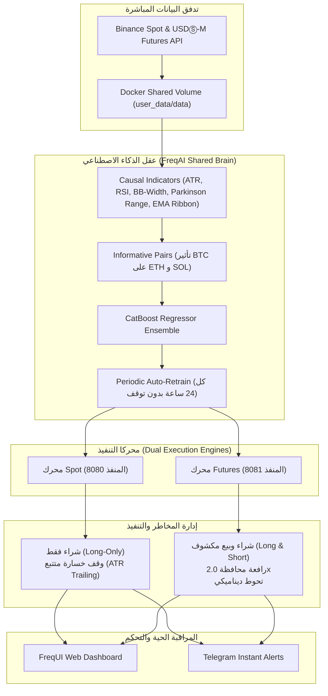

# الدليل المعماري والتشغيلي لنظام الصندوق الاستثماري الكمي المؤسسي
### Crypto Institutional Quant Fund (Dual-Engine: Spot & Futures)

---

## 🏛️ 1. فلسفة النظام المؤسسي (Institutional Quant Philosophy)

صُمم هذا النظام ليحاكي أحدث نظم الصناديق الاستثمارية الكمية العالمية (مثل Two Sigma و Renaissance Technologies) التي تعتمد على الذكاء الاصطناعي، ولا يعتمد على أساليب المضاربة العشوائية أو المؤشرات الفردية البدائية.

### المبادئ الثلاثة غير القابلة للتفاوض:
1. **فصل الأسواق (Market Segmentation):** 
   - **محرك Spot:** مخصص للأمان وتراكم الأصول الحقيقية في المحفظة بدون رافعة مالية ومستحيل أن يتعرض للتصفية (Zero Liquidation Risk).
   - **محرك Futures:** مخصص للمضاربة التكتيكية في الاتجاهين (Long & Short) والاستفادة من هبوط الأسواق والتحوط (Hedging) برافعة آمنة ومدروسة ($1.5x - 2.0x$).
2. **عقل موحد خالي من التسريب الزمني (Zero-Leakage FreqAI Engine):**
   - استخدام ميزات سببية فقط (Causal Indicators).
   - التنبؤ بنسبة العائد المستقبلي $r_{t+h}$ مع إعادة تدريب تدريجي تلقائي (Rolling Auto-Retrain) كل 24 ساعة.
3. **فلتر الشذوذ والمخاطر الصارم (Dissimilarity Index - DI):**
   - إذا واجه الذكاء الاصطناعي بيئة سوق غريبة لم يتدرب عليها من قبل (أخبار مفاجئة، فلاش كراش)، يمتنع النظام عن التداول فوراً لحماية رأس المال.

---

## 🏗️ 2. الهيكلية التقنية (System Architecture)

---

## ⚙️ 3. مكونات المشروع والملفات

| الملف / المجلد | الوظيفة |
| :--- | :--- |
| `docker-compose.yml` | يدير تشغيل الحاويتين (Spot و Futures) في نفس الوقت بعزل تام وأداء عالٍ. |
| `user_data/config_spot.json` | تكوين محرك التداول الفوري (Spot): الحساب، العملات، الفلاتر، إعدادات الذكاء الاصطناعي. |
| `user_data/config_futures.json` | تكوين محرك العقود الآجلة (Futures): الرافعة، الهامش المعزول (Isolated)، دعم الشورت. |
| `user_data/strategies/InstitutionalDualStrategy.py` | الاستراتيجية المؤسسية الموحدة التي تترجم تنبؤات الذكاء الاصطناعي إلى قرارات مالية حاسمة. |
| `download_data.bat` / `.ps1` | سكربت تنزيل البيانات التاريخية لجميع العملات والأطر الزمنية بضغطة زر. |
| `run_backtest_spot.bat` / `.ps1` | سكربت اختبار محرك الـ Spot على البيانات السابقة بمحاكاة FreqAI دقيقة. |
| `run_backtest_futures.bat` / `.ps1` | سكربت اختبار محرك الـ Futures في ظروف الهبوط والصعود. |
| `start_all_engines.bat` / `.ps1` | سكربت تشغيل النظامين معاً في الخلفية. |
| `stop_all_engines.bat` / `.ps1` | سكربت إيقاف كافة الحاويات بأمان. |

---

## 🚀 4. دليل التشغيل خطوة بخطوة

### الخطوة 1: التأكد من تشغيل Docker Desktop
تأكد من فتح تطبيق **Docker Desktop** على جهازك وظهور علامة اللون الأخضر (Engine Running) في أسفل يسار التطبيق.

### الخطوة 2: تنزيل البيانات التاريخية (Data Download)
قبل بدء أي اختبار، نحتاج لسحب بيانات سنة أو سنتين سابقتين للبيتكوين والإيثيريوم والسولانا:
- افتح موجه الأوامر واضغط مرتين على: `download_data.bat`  
*(أو شغل في PowerShell: `.\download_data.ps1`)*

### الخطوة 3: تشغيل المحاكاة التاريخية (Backtesting)
لاختبار أداء النماذج والتأكد من دقة الأرباح ومعدل التراجع:
- **لاختبار الـ Spot:** شغل `run_backtest_spot.bat`
- **لاختبار الـ Futures:** شغل `run_backtest_futures.bat`

### الخطوة 4: بدء التداول الافتراضي الحي (Dry-Run Mode)
النظام مضبوط افتراضياً على **Dry-Run (تداول تجريبي واقعي)** برصيد افتراضي قدره 10,000 USDT لكل محرك، دون المخاطرة بأي أموال حقيقية:
- اضغط مرتين على: `start_all_engines.bat`
- بعد التشغيل، يمكنك فتح لوحات التحكم من المتصفح:
  - **لوحة تحكم Spot:** `http://localhost:8080`
  - **لوحة تحكم Futures:** `http://localhost:8081`
  - **اسم المستخدم:** `fund_admin`
  - **كلمة المرور:** `InstitutionalQuant2026!`

---

## 💰 5. الانتقال إلى التداول الحقيقي برأس مال فعلي (Live Production)

عندما تحقق نتائج مستقرة في وضع الـ Dry-Run وترغب في ربط حسابك الحقيقي في Binance:

1. **إنشاء مفاتيح API في منصة Binance:**
   - فعّل صلاحيات: `Enable Reading` و `Enable Spot & Margin Trading` لمحرك Spot.
   - فعّل صلاحية `Enable Futures` لمحرك Futures.
   - **تحذير أمني صارم:** **لا تفعل أبداً** خيار السحب (`Enable Withdrawals`)!
2. **وضع المفاتيح في ملفات التكوين:**
   - افتح `user_data/config_spot.json` وضع المفاتيح في حقول `"key"` و `"secret"`، ثم غيّر `"dry_run": false`.
   - افتح `user_data/config_futures.json` وضع المفاتيح، ثم غيّر `"dry_run": false`.
3. **تفعيل إشعارات تليجرام:**
   - أنشئ بوتاً عبر `@BotFather`، وضع الـ `token` والـ `chat_id` في قسم `"telegram"` داخل كلا الملفين.
4. أعد تشغيل الحاويات عبر `start_all_engines.bat`.

---

## 🛡️ 6. معايير الأمان وإدارة المخاطر في النظام

* **رافعة مالية قصوى 2.0x (No Over-leveraging):** تمنع أي تصفية عشوائية وتضمن استدامة الحساب عبر السنين.
* **إلغاء الصفقات غير المكتملة:** إذا لم ينفذ أمر الـ Limit خلال 10 دقائق يتم إلغاؤه لحماية المحفظة من تغير السعر المفاجئ.
* **الوقف المتحرك للأرباح (Break-Even Locking):** بمجرد أن تحقق الصفقة ربحاً يتجاوز 2.5%، يرفع النظام وقف الخسارة تلقائياً إلى مستوى الدخول + الرسوم لمنع تحول الصفقات الرابحة إلى خاسرة.
